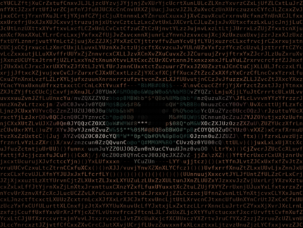

# ASCII Eye Animation & Interaction Engine 👁️

[](https://www.python.org/downloads/)
[](https://opensource.org/licenses/MIT)

A hyper-realistic parametric mathematical ASCII shader and animation engine replicating [buildmeri's *'in your eyes'*](https://www.instagram.com/reel/DeshX7jIyXP/). Built with pure Python, NumPy vectorization, and ANSI TrueColor formatting.



> 🎬 **Full Screen Recording with Sound (HD)**: [**demo.mp4**](https://github.com/ypatil2006-coder/ascii-eye/raw/main/demo.mp4) *(Watch real-time mouse tracking, blinks, and Billie Eilish - CHIHIRO in action)*

---

## ✨ Features

- **Responsive Fullscreen CLI**: Dynamically queries terminal dimensions (`shutil.get_terminal_size()`) and fills 100% of your terminal window edge-to-edge.
- **Aspect-Ratio Preservation**: Automatically accounts for the $2.05\times$ vertical character cell ratio so the eye remains perfectly circular and undistorted across standard, ultrawide, and vertical split layouts.
- **Real-Time SGR 1006 Mouse Tracking**: The eye tracks your mouse cursor anywhere across the terminal in real time (moving up looks UP, moving down looks DOWN).
- **Biological Realism**:
  - **Pupillary Hippus**: Continuous autonomic pupil dilation/constriction breathing (~1.5Hz).
  - **3D Corneal Curvature**: Perspective elliptical foreshortening of the iris when glancing off-axis.
  - **Optical Parallax Catchlights**: Stationary external light reflections sliding across the curved cornea.
  - **Scleral Micro-Capillaries**: Delicate branching vascular blood vessels threading from the corners of the eye.
  - **Lacrimal Caruncle**: Fleshy pink mucosal nodule at the inner nasal canthus.
  - **Wet Tear Meniscus**: Glistening specular reflection along the lower eyelid waterline.
  - **Tschermak's Eyelid Lag**: Eyelids follow the vertical orientation of the cornea.
  - **Fixational Eye Movements**: High-frequency physiological tremor (~40Hz) and microsaccadic corrections.
- **Soundtrack Integration**: Plays Billie Eilish - *CHIHIRO* in the background using `mpv`.
- **Desktop GUI Mode**: Includes an optional Tkinter canvas renderer (`--gui`) matching the original *"Eye -> Space"* setup.

---

## 🕹️ Controls & Interaction

| Control | Action |
| :--- | :--- |
| **Mouse Cursor** | The eye follows your cursor across the terminal |
| **Left Click** | Triggers an immediate natural blink |
| **Right Click** | Triggers a dynamic glance & blink sequence |
| **Spacebar / Enter** | Triggers glance & blink animation sequence |
| **Arrow Keys (<kbd>↑</kbd> <kbd>↓</kbd> <kbd>←</kbd> <kbd>→</kbd>)** | Manually direct gaze |
| **Scroll Wheel (<kbd>↑</kbd> / <kbd>↓</kbd>)** | Tilt gaze up or down |
| **<kbd>M</kbd>** | Toggle background soundtrack (*CHIHIRO*) |
| **<kbd>Q</kbd> / <kbd>Esc</kbd> / <kbd>Ctrl+C</kbd>** | Clean exit (restores terminal state cleanly) |

---

## 🚀 Quick Start

### 1. Requirements

Ensure you have Python 3.8+ installed:

```bash
git clone https://github.com/ypatil2006-coder/ascii-eye.git
cd ascii-eye
pip install -r requirements.txt
```

*(Optional)* Install `mpv` for audio playback support:
```bash
# Arch Linux
sudo pacman -S mpv

# Ubuntu / Debian
sudo apt install mpv
```

### 2. Run in Terminal (CLI Mode)

```bash
python3 eye.py
```

### 3. Optional Command Flags

```bash
python3 eye.py --music            # Auto-play CHIHIRO soundtrack on start
python3 eye.py --scale 2.0        # Make the eye even larger (default: 1.65)
python3 eye.py --fps 60           # Run at high refresh rate (default: 30)
python3 eye.py --gui              # Launch Tkinter Desktop Window mode
```

---

## 📐 How It Works

1. **Parametric Mathematical Shader**:
   The eyelid arches, crease lines, lash spikes, sclera, iris spokes, and pupil are defined through continuous mathematical distance functions (`smoothstep`, Gaussian curves, trigonometric wave harmonics, and exponential decay).
2. **Procedural Noise**:
   Smooth bilinear noise textures (`tx_skin`, `tx_detail`, `tx_fibers`) are computed via NumPy to generate organic skin pores and iris striations.
3. **SGR 1006 Terminal Mouse Protocol**:
   Terminal mode enables raw cbreak input alongside `\033[?1003h\033[?1006h` escape sequences, parsing mouse movements and button events without blocking the 30-60 FPS render pipeline.
4. **Flicker-Free Alternate Screen Buffer**:
   Uses `\033[?1049h` and disabled line auto-wrapping (`\033[?7l`), writing full-screen frames into `\033[H` to prevent terminal scroll bounce.

---

## 📄 License

MIT License. Feel free to use, modify, and build upon this engine.
